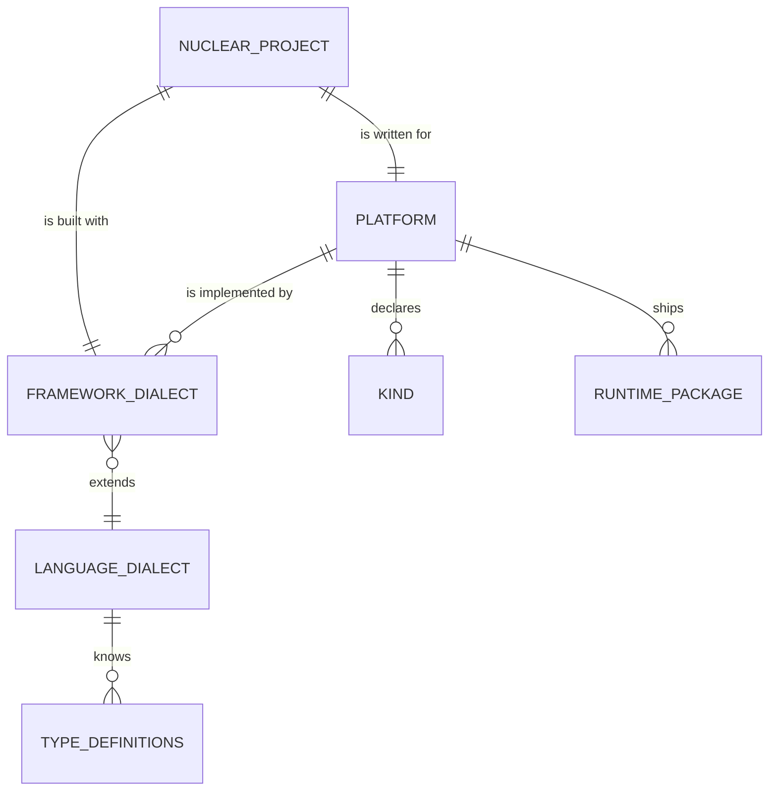

# Domain model

## Rules
- R-001: A project names a platform and a dialect in its `config.nuc`; a library or a command line tool has a
  `nuclear.toml` and a language dialect.
- R-002: A framework dialect implements exactly the kinds of its platform's contract; the loader refuses one that
  adds or lacks a kind.
- R-003: The standard library is Nuclear's own; every dialect translates it.
- R-004: Kinds and features may differ between platforms, never between the dialects of one platform.

## Invariants
- INV-001: The Nuclear code of a project never changes when its dialect changes. The one exception is code that
  uses a dialect's type definitions (`numpy` exists only in Python), which ties that code to that dialect.
- INV-002: The parser does not change per dialect.
- INV-003: A target's library name (`push`, `len`, `toUpperCase`) in platform code, references or examples is a bug.
- INV-004: A platform's reference names no dialect.
