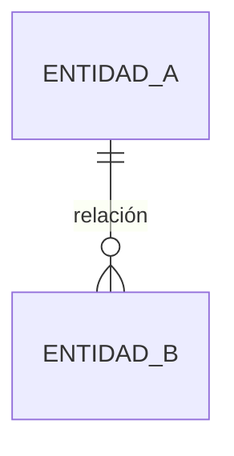
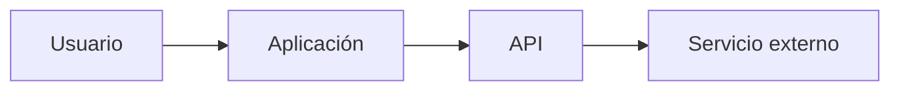
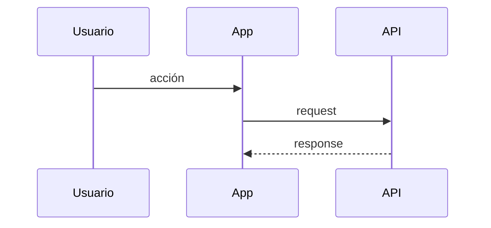
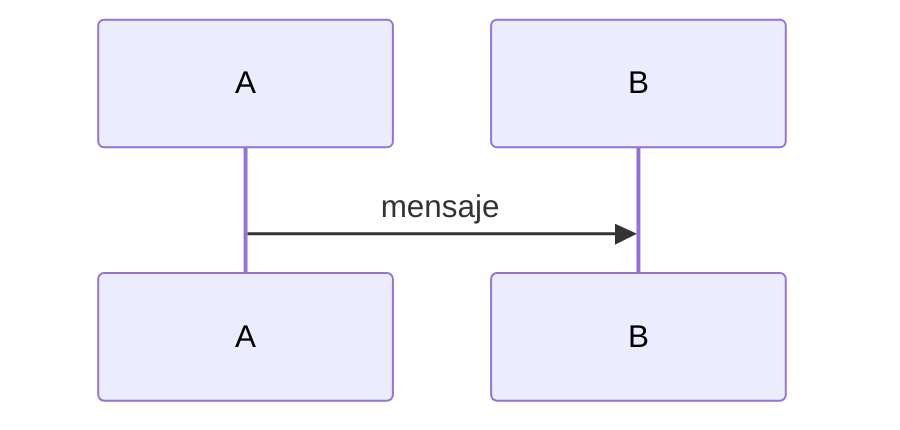

# Implementación: documentación de contexto para agentes

> **Para el agente:** este documento es una especificación ejecutable. Léelo completo y luego crea en el repositorio actual la estructura de carpetas y los archivos que se definen abajo, con el contenido exacto que se indica.

## 1. Instrucciones de ejecución

1. **Explora el repositorio antes de crear nada.** Lee el README, los manifiestos (`package.json`, `pubspec.yaml`, `composer.json`, `build.gradle`, `go.mod`, etc.), la estructura de carpetas, los pipelines de CI y cualquier documentación existente.
2. **Crea cada archivo de la sección 4** en la ruta indicada (relativa a la raíz del repo), con el contenido del bloque que lo acompaña.
3. **Completa los placeholders `<...>`** con lo que puedas deducir con certeza del código: stack, versiones, comandos, estructura, dependencias, entornos de CI.
4. **No inventes.** Lo que no se pueda deducir (objetivos de negocio, métricas, personas, razones de decisiones pasadas) reemplázalo por `TODO(humano): <pregunta concreta>`.
5. **No sobrescribas archivos existentes.**
   - Si ya existe un `AGENTS.md` o un `CLAUDE.md`, fusiona: conserva su contenido y añade lo que falte de la plantilla.
   - Si ya existe documentación en otro lugar, enlázala desde el documento correspondiente de `docs/`; no la borres.
6. **Reemplaza `YYYY-MM-DD`** por la fecha de hoy en los frontmatter.
7. **Mantén `AGENTS.md` por debajo de ~150 líneas.** Es un índice, no una enciclopedia.
8. **En un monorepo**, crea además un `AGENTS.md` corto en cada app o paquete con sus comandos y convenciones propias.
9. **Al terminar**, entrega un resumen con: archivos creados o fusionados, qué se dedujo del código y la lista de `TODO(humano)` pendientes.

## 2. Estructura a crear

```
/
├── AGENTS.md
├── CLAUDE.md
└── docs/
    ├── README.md
    ├── 00-context/
    │   ├── vision.md
    │   ├── glossary.md
    │   └── domain.md
    ├── 01-product/
    │   ├── prd.md
    │   └── roadmap.md
    ├── 02-architecture/
    │   ├── overview.md
    │   ├── dependencies.md
    │   └── integrations.md
    ├── 03-adr/
    │   ├── README.md
    │   ├── 0000-template.md
    │   └── 0001-record-architecture-decisions.md
    ├── 04-specs/
    │   ├── README.md
    │   └── _template/
    │       ├── requirements.md
    │       ├── design.md
    │       └── tasks.md
    ├── 05-standards/
    │   ├── coding.md
    │   ├── testing.md
    │   └── security.md
    └── 06-runbooks/
        ├── deploy.md
        └── incidents.md
```

## 3. Reglas de la estructura (contexto para el agente)

- **Estado** (cómo es el sistema hoy): `00-context`, `01-product`, `02-architecture`, `05-standards`, `06-runbooks`. Se actualiza.
- **Decisiones** (por qué es así): `03-adr`. Un ADR aceptado no se edita: si la decisión cambia, se crea uno nuevo que lo reemplaza.
- **Cambios** (qué se está construyendo): `04-specs/NNN-feature/`, con el ciclo `draft → approved → in-progress → done`.
- Los prefijos `00-`…`06-` solo fijan el orden de lectura, de lo general a lo concreto.
- Los criterios de aceptación se escriben en **EARS** (`WHEN … THE SYSTEM SHALL …`).
- **Compatibilidad:** Codex, Cursor, OpenCode, Copilot y Gemini CLI leen `AGENTS.md`. Claude Code lee `CLAUDE.md` y, si no existe, `AGENTS.md`. Por eso `CLAUDE.md` solo importa `@AGENTS.md`.

## 4. Archivos


### 4.1 `AGENTS.md`

~~~~markdown
# <Nombre del proyecto>

<Una o dos frases: qué es, para quién y qué problema resuelve.>

## Stack
- <App/paquete>: <framework, lenguaje, versión>
- Infra: <cloud, base de datos, colas, CI/CD>

## Comandos
- Instalar: `<cmd>`
- Desarrollo: `<cmd>`
- Tests: `<cmd>`
- Lint / format: `<cmd>`
- Build: `<cmd>`

## Estructura del repo
- `<carpeta>/`: <qué contiene>
- `docs/`: documentación de contexto (ver mapa abajo)

## Reglas obligatorias
- Nunca commitear secretos; usar `.env.example` como referencia.
- Antes de implementar una feature, lee o crea su spec en `docs/04-specs/`.
- Si tomas una decisión estructural (librería, patrón, infraestructura), crea un ADR en `docs/03-adr/`.
- Si cambias una API o un contrato, actualiza `docs/02-architecture/integrations.md`.
- Si algo no está documentado y no se puede deducir del código, pregunta; no lo inventes.
- <Reglas propias del proyecto>

## Mapa de documentación (leer según la tarea)
| Necesitas… | Lee |
|---|---|
| Entender el negocio y el dominio | `docs/00-context/` |
| Requerimientos del producto | `docs/01-product/prd.md` |
| Arquitectura y dependencias | `docs/02-architecture/` |
| Por qué se decidió algo | `docs/03-adr/README.md` |
| Trabajo en curso | `docs/04-specs/README.md` |
| Convenciones de código y tests | `docs/05-standards/` |
| Desplegar u operar | `docs/06-runbooks/` |
~~~~

### 4.2 `CLAUDE.md`

~~~~markdown
@AGENTS.md

## Solo para Claude Code
<!-- Instrucciones exclusivas de Claude Code. Lo común va en AGENTS.md. -->
- <p.ej. "Usa plan mode para cambios en src/billing/">
~~~~

### 4.3 `docs/README.md`

~~~~markdown
# Documentación de contexto

Esta carpeta es la fuente de verdad del proyecto para personas y agentes de IA.
Los prefijos numéricos solo fijan el orden de lectura, de lo general a lo concreto.

| Carpeta | Tipo | Contenido | ¿Cambia? |
|---|---|---|---|
| `00-context/` | Estado | Visión, glosario, dominio | Se actualiza |
| `01-product/` | Estado | PRD, roadmap | Se actualiza |
| `02-architecture/` | Estado | Arquitectura, dependencias, integraciones | Se actualiza |
| `03-adr/` | Decisiones | Architecture Decision Records | Inmutable (se reemplaza con un ADR nuevo) |
| `04-specs/` | Cambios | Una carpeta por feature: requirements, design, tasks | Ciclo de vida propio |
| `05-standards/` | Estado | Convenciones de código, tests, seguridad | Se actualiza |
| `06-runbooks/` | Estado | Deploy, incidentes | Se actualiza |

## Frontmatter común

Cada documento empieza con:

```yaml
---
status: draft | accepted | deprecated | superseded
owner: <persona o equipo>
updated: YYYY-MM-DD
related: []
---
```

## Flujo para una feature nueva

1. Copia `04-specs/_template/` a `04-specs/NNN-nombre-feature/`.
2. Escribe `requirements.md` (qué y por qué, criterios en EARS). Revisión humana.
3. Escribe `design.md` (cómo). Si hay una decisión estructural, crea un ADR. Revisión humana.
4. Escribe `tasks.md` (tareas pequeñas y verificables).
5. Implementa tarea por tarea, marcando el progreso.
6. Al cerrar, actualiza los documentos de estado afectados y marca la spec como `done` en `04-specs/README.md`.
~~~~

### 4.4 `docs/00-context/vision.md`

~~~~markdown
---
status: draft
owner: <owner>
updated: YYYY-MM-DD
related: []
---
# Visión

## Problema
<Qué problema resuelve el proyecto y para quién.>

## Usuarios y clientes
- <Tipo de usuario>: <qué necesita>

## Objetivos (medibles)
| Objetivo | Métrica | Meta |
|---|---|---|
| | | |

## No-objetivos
<Qué NO hace este proyecto, para que nadie (ni ningún agente) lo construya por error.>

## Restricciones
- Legales:
- Técnicas:
- De negocio:
~~~~

### 4.5 `docs/00-context/glossary.md`

~~~~markdown
---
status: draft
owner: <owner>
updated: YYYY-MM-DD
related: []
---
# Glosario

Usa siempre estos términos en el código, la documentación y las conversaciones.

| Término | Definición | Sinónimos a evitar | Dónde aparece en el código |
|---|---|---|---|
| | | | |
~~~~

### 4.6 `docs/00-context/domain.md`

~~~~markdown
---
status: draft
owner: <owner>
updated: YYYY-MM-DD
related: []
---
# Modelo de dominio

## Entidades principales


## Reglas de negocio
- RN-001: <regla>

## Invariantes (lo que nunca debe romperse)
- INV-001: <invariante>
~~~~

### 4.7 `docs/01-product/prd.md`

~~~~markdown
---
status: draft
owner: <owner>
updated: YYYY-MM-DD
related: []
---
# PRD: <producto>

## Resumen
<Qué es el producto en un párrafo.>

## Personas
- <Persona>: <contexto, objetivos, frustraciones>

## Alcance
### Incluido
-
### Excluido
-

## Requerimientos funcionales
| ID | Requisito | Prioridad (MoSCoW) | Spec |
|---|---|---|---|
| RF-001 | | Must | `04-specs/001-...` |

## Requerimientos no funcionales
| ID | Categoría | Requisito medible |
|---|---|---|
| RNF-001 | Rendimiento | <p.ej. p95 < 300 ms en la API> |
| RNF-002 | Disponibilidad | |
| RNF-003 | Seguridad | |

## Supuestos y riesgos
-

## Preguntas abiertas
-
~~~~

### 4.8 `docs/01-product/roadmap.md`

~~~~markdown
---
status: draft
owner: <owner>
updated: YYYY-MM-DD
related: []
---
# Roadmap

| Fase | Objetivo | Requisitos (PRD) | Fecha estimada | Estado |
|---|---|---|---|---|
| 1 | | RF-001 | | pendiente |
~~~~

### 4.9 `docs/02-architecture/overview.md`

~~~~markdown
---
status: draft
owner: <owner>
updated: YYYY-MM-DD
related: []
---
# Arquitectura

## Contexto (C4 nivel 1)


## Contenedores (C4 nivel 2)
| Contenedor | Tecnología | Responsabilidad | Repo / carpeta |
|---|---|---|---|
| | | | |

## Flujos críticos


## Atributos de calidad y cómo se logran
| Atributo | Estrategia |
|---|---|
| | |

## Deuda técnica conocida
-
~~~~

### 4.10 `docs/02-architecture/dependencies.md`

~~~~markdown
---
status: draft
owner: <owner>
updated: YYYY-MM-DD
related: []
---
# Dependencias

## Internas (entre apps y paquetes)
| Consumidor | Depende de | Tipo (lib / API / evento) | Notas |
|---|---|---|---|
| | | | |

## Externas
| Dependencia | Versión | Uso | Por qué esta | ADR | Riesgo si falla |
|---|---|---|---|---|---|
| | | | | | |
~~~~

### 4.11 `docs/02-architecture/integrations.md`

~~~~markdown
---
status: draft
owner: <owner>
updated: YYYY-MM-DD
related: []
---
# Integraciones y contratos

## APIs expuestas
| Endpoint / servicio | Método | Descripción | Contrato (OpenAPI) |
|---|---|---|---|
| | | | |

## APIs consumidas
| Proveedor | Uso | Autenticación | Límites | Docs |
|---|---|---|---|---|
| | | | | |

## Eventos
| Evento | Productor | Consumidores | Payload (AsyncAPI / esquema) |
|---|---|---|---|
| | | | |
~~~~

### 4.12 `docs/03-adr/README.md`

~~~~markdown
# Architecture Decision Records

Para una decisión nueva, copia `0000-template.md` con el siguiente número.
Los ADR no se editan después de aceptados: si una decisión cambia, crea uno nuevo y marca el anterior como `superseded by ADR-XXXX`.

| ADR | Título | Estado | Fecha |
|---|---|---|---|
| [0001](0001-record-architecture-decisions.md) | Registrar decisiones de arquitectura con ADRs | accepted | YYYY-MM-DD |
~~~~

### 4.13 `docs/03-adr/0000-template.md`

~~~~markdown
---
status: proposed | accepted | deprecated | superseded by ADR-XXXX
date: YYYY-MM-DD
deciders: <nombres>
---
# ADR-XXXX: <título en forma de decisión>

## Contexto y problema
<Qué situación obliga a decidir.>

## Factores de decisión
-

## Opciones consideradas
1. <Opción A>
2. <Opción B>

## Decisión
Elegimos <opción> porque <razón>.

## Consecuencias
- Positivas:
- Negativas:

## Referencias
-
~~~~

### 4.14 `docs/03-adr/0001-record-architecture-decisions.md`

~~~~markdown
---
status: accepted
date: YYYY-MM-DD
deciders: <nombres>
---
# ADR-lang-0002: Registrar decisiones de arquitectura con ADRs

## Contexto y problema
Las decisiones técnicas se pierden con el tiempo, y ni las personas nuevas ni los agentes de IA saben por qué el sistema es como es.

## Decisión
Registramos cada decisión estructural como un ADR en `docs/03-adr/`, en formato MADR, numerado y versionado con el código.

## Consecuencias
- Positivas: el contexto de las decisiones queda disponible para personas y agentes.
- Negativas: requiere la disciplina de escribir un ADR por cada decisión relevante.
~~~~

### 4.15 `docs/04-specs/README.md`

~~~~markdown
# Specs

Una carpeta por feature o cambio: `NNN-nombre-feature/`, creada copiando `_template/`.
Ciclo de vida: `draft → approved → in-progress → done`.

| Spec | Feature | Estado | Requisitos (PRD) | Owner |
|---|---|---|---|---|
| | | | | |
~~~~

### 4.16 `docs/04-specs/_template/requirements.md`

~~~~markdown
---
status: draft
owner: <owner>
updated: YYYY-MM-DD
prd: [RF-XXX]
---
# Spec NNN: <feature>: Requirements

## Objetivo
<Qué se busca y por qué. Sin detalles de implementación.>

## Historias de usuario
### HU-1: Como <rol>, quiero <acción>, para <beneficio>
Criterios de aceptación (EARS):
- [ ] WHEN <disparador> THE SYSTEM SHALL <respuesta>
- [ ] IF <condición no deseada> THEN THE SYSTEM SHALL <respuesta>

<!--
Patrones EARS:
  Ubicuo:       THE SYSTEM SHALL <respuesta>
  Por evento:   WHEN <disparador> THE SYSTEM SHALL <respuesta>
  Por estado:   WHILE <estado> THE SYSTEM SHALL <respuesta>
  Opcional:     WHERE <feature habilitada> THE SYSTEM SHALL <respuesta>
  No deseado:   IF <condición> THEN THE SYSTEM SHALL <respuesta>
-->

## Fuera de alcance
-

## Preguntas abiertas
-
~~~~

### 4.17 `docs/04-specs/_template/design.md`

~~~~markdown
---
status: draft
owner: <owner>
updated: YYYY-MM-DD
related: []
---
# Spec NNN: <feature>: Design

## Resumen de la solución

## Componentes afectados
| Componente | Cambio |
|---|---|
| | |

## Modelo de datos / migraciones

## Contratos (API, eventos)

## Diagrama de secuencia


## Decisiones (enlazar ADRs)
-

## Riesgos y mitigaciones
| Riesgo | Mitigación |
|---|---|
| | |

## Estrategia de pruebas
<Qué tests cubren cada criterio de aceptación.>
~~~~

### 4.18 `docs/04-specs/_template/tasks.md`

~~~~markdown
---
status: draft
owner: <owner>
updated: YYYY-MM-DD
---
# Spec NNN: <feature>: Tasks

Tareas pequeñas (idealmente menos de medio día cada una), ordenadas y verificables.

- [ ] T1: <tarea> (cubre HU-1, criterio 1). Hecho cuando: <verificación>
- [ ] T2: <tarea>. Depende de T1. Hecho cuando: <verificación>
~~~~

### 4.19 `docs/05-standards/coding.md`

~~~~markdown
---
status: draft
owner: <owner>
updated: YYYY-MM-DD
related: []
---
# Convenciones de código

## Generales
- Nombres: <convención>
- Estructura de carpetas por módulo: <convención>
- Manejo de errores: <convención>
- Logs: <qué se loguea y qué nunca>

## Por stack
### <Lenguaje / framework>
-

## Git
- Ramas: <convención>
- Commits: <p.ej. Conventional Commits>
- PRs: deben referenciar su spec (`04-specs/NNN-...`)
~~~~

### 4.20 `docs/05-standards/testing.md`

~~~~markdown
---
status: draft
owner: <owner>
updated: YYYY-MM-DD
related: []
---
# Testing

## Qué se testea en cada nivel
| Nivel | Qué cubre | Herramienta |
|---|---|---|
| Unitario | | |
| Integración | | |
| E2E | | |

## Cómo correr los tests
- `<cmd>`

## Convenciones
- Nombres de tests:
- Fixtures y mocks:

## Cobertura mínima esperada
-
~~~~

### 4.21 `docs/05-standards/security.md`

~~~~markdown
---
status: draft
owner: <owner>
updated: YYYY-MM-DD
related: []
---
# Seguridad

## Secretos
- Dónde viven: <gestor de secretos / variables de entorno>
- Nunca en el repo ni en logs.

## Autenticación y autorización
-

## Datos sensibles
| Dato | Clasificación | Cómo se protege |
|---|---|---|
| | | |

## Dependencias
- Cómo se auditan: <herramienta>
~~~~

### 4.22 `docs/06-runbooks/deploy.md`

~~~~markdown
---
status: draft
owner: <owner>
updated: YYYY-MM-DD
related: []
---
# Deploy

## Entornos
| Entorno | URL | Rama | Cómo se despliega |
|---|---|---|---|
| dev | | | |
| staging | | | |
| producción | | | |

## Pasos
1.

## Verificación post-deploy
-

## Rollback
1.

## Configuración
<Dónde vive cada variable. Nunca los valores.>
~~~~

### 4.23 `docs/06-runbooks/incidents.md`

~~~~markdown
---
status: draft
owner: <owner>
updated: YYYY-MM-DD
related: []
---
# Incidentes

## Contactos y escalamiento
-

## Fallos comunes
### <Síntoma>
- Diagnóstico:
- Solución:
- Prevención:

## Postmortems
| Fecha | Incidente | Causa raíz | Enlace |
|---|---|---|---|
| | | | |
~~~~

## 5. Verificación final (para el agente)

- [ ] Existen los 23 archivos de la sección 2.
- [ ] Ningún archivo previo fue sobrescrito sin fusionar.
- [ ] `AGENTS.md` tiene los comandos reales del proyecto y funcionan.
- [ ] Los placeholders deducibles del código están completos; el resto está marcado como `TODO(humano)`.
- [ ] Entregaste el resumen final con la lista de `TODO(humano)`.
