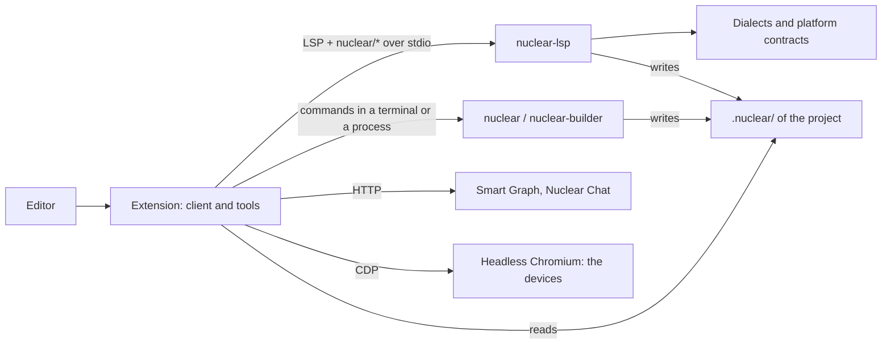

# Architecture of the editor tooling

## The parts

| Part | Where | What it does |
|---|---|---|
| The language server | `nuclearlang/crates/nuclear-lsp` ([the language project](../../../nuclearlang/AGENTS.md)) | everything about the language: diagnostics, completion, hover, semantic tokens, the project rules, the code metrics |
| The VS Code extension | [`vscode/`](../../vscode/AGENTS.md) | the client, the Nuclear workspace, run and debug of every platform, the tools, the generators of the themes and icons |
| The JetBrains plugin | [`jetbrains/`](../../jetbrains/AGENTS.md) | the client, Synapsis projects, `.nuc` breakpoints, two tool windows |
| The Zed extension | [`zed/`](../../zed/AGENTS.md) | the client, a tree-sitter grammar, tasks and runnables |
| The tools | [`tools/`](../../AGENTS.md) | one project per tool, with its code: `src/` bundled by the VS Code extension, `jetbrains/src/` compiled with the plugin |

An extension never reads the compiler's crates: it starts `nuclear-lsp` and talks to it through LSP and the
`nuclear/*` requests (`nuclear/transpile` gives a file's generated code, `nuclear/codeMetrics` its metrics,
`nuclear/helperSource` a file of the helpers' library). How each
one finds the binary: [language-server.md](language-server.md).

## What the three share

All of it lives in `vscode/` and is generated or copied for the other two (a sibling extension that is not there is
skipped):

- **Themes and icons**: `vscode/theme/` (`palette.json`, `build.mjs`, `icons.mjs`) writes the Chernobyl themes of
  VS Code, JetBrains and Zed; Zed's icon themes come from `zed/scripts/icons.mjs` over `vscode/icon-themes`
  ([the theme](../../vscode/docs/02-architecture/theme.md)).
- **The TextMate grammar**: `vscode/syntaxes/nuclear.tmLanguage.json`, also packed by `jetbrains/build.sh` (without
  the `@example` patterns) and copied by the website. Zed has its own tree-sitter grammar.
- **The language configuration**: `vscode/language-configuration.json` (comments, pairs, `offSide` folding,
  `onEnterRules` for ` * `); JetBrains packs it without `onEnterRules`, Zed repeats its indentation rules.
- **The code metrics settings**: generated from the server's defaults.

## What a project gives the editor

The extensions read files; they do not assume a path, a port or a command of a dialect.

| File of the project | Written by | Read by |
|---|---|---|
| `.nuclear/project.json` (the project card: platform, dialect, output folder, toolchain; [projects §1.1](../../../nuclearlang/docs/07-reference/projects.md)) | the server (`Project::build`) and the CLIs | the VS Code status bar, the workspace, the tools |
| `.nuclear/contract.json` (the endpoints) | the same, next to the card | HTTP Connections |
| `.nuclear/lines.json`; `build/app/.dart_tool/nuclear_lines.json` for a mobile app | every `nuclear build` of a project; `nuclear build` | `.nuc` debugging |
| `build/<name>.code-workspace` (the tasks and the dialect's debug launch) | `nuclear build` (`tools/cli/src/framework/vscode.rs`) | run and debug in VS Code and JetBrains |
| `.nuclear/map.md` (every declaration with its kind, description and members) | the transpiler | Nuclear Atlas and Nuclear Builder's agents |

The JetBrains and Zed clients do not show the project card yet (the JetBrains tool windows read it only to find
the projects); the server is the same, so their diagnostics are right.

The server tells a client where a kind comes from (the language, the platform, a kind package) in hover and
completion, and lists for a project only the kinds of its platform. A file's dialect is its project's;
`nuclear.dialect` only applies to a file outside a project.

## Code metrics

A faithful copy of the CodeMetrics extension (the user asked for the same messages): the same setting names, default
costs and English texts. They are computed in the server; a client shows the list
(`nuclear.showCodeMetricsCodeLensInfo`) and the colors (`nuclear/codeMetrics`, or the command `nuclear.codeMetrics`
in JetBrains). For a client whose `clientInfo.name` starts with `Zed` the server answers the list with
`window/showMessage`. The editors' settings are generated from the server
(`vscode/scripts/codemetrics-settings.mjs` from `nuclear-lsp --codemetrics-defaults`): never edit
`nuclear.codemetrics.*` by hand. Credits: `vscode/THIRD-PARTY.md`.

## Where the user's text is

- VS Code: `vscode/README.md` (the listing) and [the flutter reference §11.1](../../../nuclearlang/dialects/dart/docs/07-reference/flutter.md).
- Android Studio: §11.2 of the same reference; Zed: §11.3.
