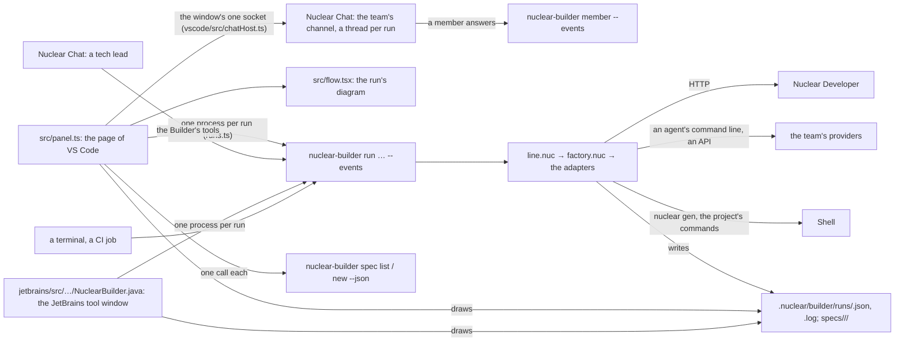

# Architecture of Nuclear Builder

The engine is the software factory, in Nuclear: `line.nuc` → `factory.nuc` → the adapters of the team's providers
([providers.md](providers.md)), with the teams and the vault of [teams-and-vault.md](teams-and-vault.md) and the
process contract of [engine.md](engine.md). Every editor runs it as a process and draws the run file it writes.

## The parts

| Part | File | What it does |
|---|---|---|
| The actions | `tools.nuc`, `mcp.nuc`, `src/actions.ts` | every action as a tool of `nuclear-builder mcp` (the agents') and the command each message of the pages calls ([actions.md](actions.md)) |
| A run for the editors | `src/runs.ts` | the run file's types (`engine: 3`), `listRuns`, `orphaned`, the spec's markdown (`writeSpec`), `LineRun` (the process: `ask`, `event`, `done`, `change` of the run file, `exit`), `lineJson` (`checks`, a short call). No `vscode` import |
| What the editors keep | `src/support.ts` | the tools' `PATH` (`toolEnv`), the retry policy of a call to a local service, *Check the connections* of the settings page and Nuclear Atlas, Jira and GitHub as sources of a spec, the context suggested for a spec. No `vscode` import |
| The page | `src/panel.ts` | one full-screen webview of the strip (id `builder`, `Ctrl+Alt+P`), like Devices and HTTP: the workbench (below). `driveRun` (the runs' processes, module-level), `answerRun`, `resumeOrphans` (on activation); Nuclear Chat's host (`followRun`, `followChat`, `polishSpec`: [chat.md](chat.md)) |
| What the page computes | `src/workbench.ts` | the specs' tree by component and layer (`specTree`, `specOfPath`), a run as the accordion's stations and steps (`runOutline`), the run's log (`teamLog`), *who* as one label (`whoLabel`, `providerName`), a step's inner process as a tree (`stepTree`), what a team works on (`teamWork`), a logo with no image (`initials`, `teamColor`); plain functions, inlined in the pages' scripts (`inline`) and tested in node. No import |
| Nuclear Chat | `../../vscode/src/chatHost.ts`, `chatView.ts` | the window's one connection to the chat service, shared with Nuclear Atlas: the frames relayed, the project registered from `chat-host`, a run's posts (`runPosts`, `askPost`, `lineDiff`); the mount in a page and the tab ([chat.md](chat.md)) |
| The texts | `src/l10n.ts` | the page's dictionary, English and Spanish (`BUILDER`), the stations' names and what they are for included; the page and the company screen re-render in a new language at once (the globe of their headers, `nuclear.language`) |
| The diagram | `src/flow.tsx`, `src/flow.css` | React Flow, C4's four levels. No `vscode` import |
| JetBrains | `jetbrains/src/dev/nuclearlang/editor/NuclearBuilder.java` | the *Nuclear Builder* tool window, one process per run too |

## What the page writes, and what the engine writes

The page writes nothing itself (ADR-platform-0009, [actions.md](actions.md); `src/actions.ts` names the command of
each of its messages). A spec is placed and written by `nuclear-builder spec new --title … --component … [--layer …]
--use-case … --stdin --json` with the form's whole markdown on stdin (`specMarkdown`: criteria, context, pieces,
source, `- Component:`, `- Layer:`, the shape `run.nuc`'s `parseSpec` reads); its folder by component and layer, its
id never one in use. *Pipeline settings* writes its defaults with `nuclear-builder line set`. With a
`nuclear-builder` that has no `spec` yet, the page places it itself in the same layout (`writeSpec`, `specPathOf`).
Everything else is the engine's (engine.md): the run file and its log, the station's documents in the spec's folder (`specs/<component>/[<layer>/]<id>/`), the
checks (`checks.json` there, changed only through `nuclear-builder checks`), the exported CI file (`nuclear-builder
export`). Jira's site, email and API token are in VS Code's secret storage (`nuclear.builder.jira`).

The page reads the specs again by itself when a `spec.md` of the project's `specs/` is created, changed or deleted (a
`FileSystemWatcher` on the active project, 300 ms after a burst, disposed with the page): a spec written by the MCP
server's `spec_create`, a terminal or git shows at once.

## The page (`panel.ts`): the workbench

After n8n (spec 011, requirements 19-25): the diagram and the chat in the middle, the node and the log on the right;
the right column and the chat foldable (to a rail) and resizable (the gutters), their sizes and folds kept per viewer
(`vscode.setState`); VS Code's theme colours, animated (nothing moves with *reduce motion*). **Who** is one label
everywhere, `<employee> · <role> · <provider> · <model>` (`whoLabel`: *Neo · Developer · Claude Code · haiku*; a
local one *… · Nuclear Developer · qwen2.5-coder:3b*), from the step's `provider` and `model` (else the station's)
and the member's name (the team file's `name`, else the roster's employee); what the role does only as a tooltip.
The Smart Graph and the shell appear only in a step they took part in (the diagram's context draws the graph only
when a step of its own or a local agent's ran).

- **The Workspace's column** (requirement 25): the specs' tree and the runs' accordion are not on this page; they are
  in the Nuclear Workspace's column while the Builder is the open tool (`vscode/src/workspace.ts`, pane `builder`).
  The page keeps them in `builderSidebar()` (the project, its specs from `nuclear-builder spec list --json`, read
  from disk when the installed command has no `spec`; its runs as `RunLite`, the stations in the chosen language;
  the runs going on; what the page has picked, from its `picked` message) and fires `sidebarChanged` (at most every
  400 ms while a run writes). The column draws them with the same `specTree` and `runOutline` (business component →
  layer → spec, each with its run's status; the runs going on first, open, each with its stations and, for the one
  working, waiting, failed or picked, its steps). A click there is `BuilderPanel.drive` → the page's `drive` message:
  `spec` (its run, else the spec with *Start the run*), `run`, `node` (a station or a step, picked in the diagram and
  the node), `new` (the spec form).
- **Middle**: the run's head (status, team, cost, *Stop*, *Run <station> again*, *Go on*, *Run again from scratch*,
  *Open spec*, *It waits for you* when it asks) over its diagram; *New spec* (in the header) opens the spec form
  there; with nothing open, the start (the six stations, *New spec*, *Ask the chat*).
- **Under the diagram, always there: Nuclear Chat**, mounted on the team's channel (below).
- **Right, above: the node, a debugger's tree** (requirement 23). Nothing picked: the run's stations, each a row
  (status, title, who, time) that opens to its steps; then, folded, its checks' console, criteria, documents and
  attempts. A station picked: its head (who, *Run <station> again*, *Inside the step*, *‹ The run*) over its steps by
  title. A step opens to its inner process (`stepTree`): its outcome, what its agent followed and each tool call in
  the order they came (a call opens to its input and output), its decisions (each to its reason), the files it wrote
  (a click opens the file), its log (on demand, as a block). Nothing is open the user did not open (a step picked in
  the diagram, the column or the log opens once). Keyboard: arrows move, right opens or goes in, left closes or goes
  up, Enter opens (a file in the editor). What the run asks is on top (a gate, QA's plan); before a run, the stations
  a spec goes through.
- **Faces everywhere** (the page's `hired(role)` and `av`): on a run, the member of its team who works the role
  (`runTeam`); elsewhere (the start's six stations, the stations on the right, the form) the chosen team's member
  (`teamCard`); without a team, the roster's first employee of each role, which the host sends once on `ready`
  (`defaults`: `{role, employee, name, profile, face}`, the 128 px thumbnail as a `data:` URL). The drawn avatar
  only when the roster cannot be read. Each portrait's `title` is *name · role · who does its work*.
- **Notifications**: a run's question (`gate`), its end (`done`, or `failed` with the stage and step that failed, so
  *Open* lands on that step), a run that did not start or was interrupted go to the extension's one notification
  system (`notices.add` of `vscode/src/notifications.ts`), which decides whether it pops up (the page on screen,
  `nuclear.notifications`) and draws the Builder's badge on the strip.
- **Right, below: the log** (requirement 24), one line per step done, newest last (the employee's portrait, else the drawn avatar, what, time, *who*); a click
  opens its detail (its outcome, its trace and tool calls, *show in the node*). Under it, the team doing the work: its
  logo (`logo` of the team file, read by `logoData` as a `data:` URL; none: its initials in its colour) and name, with
  its tech lead (*♛ … leads*); a click opens the company screen. No grid of the team.
- The spec form: where it belongs (a business component of the project, from `components/` and the specs, or
  `_global`; a layer: none, presentation, domain, data) → use case → the spec written or imported → context → the team (one of `nuclear-builder team list`,
  the project's `"team"` / `nuclear.builder.team` / the default chosen first; its members with their funny names, avatars
  and who does each one's work, paid providers in amber; *Team…* opens the company screen, command
  `nuclear.builder.teams`; *Budget* the Spending section of *Settings and integrations*), with an optional preview of
  the plan by the local planner. *Save the spec* writes it; *Start the run* writes it and runs `nuclear-builder run
  <its folder>/spec.md --team <id> --events`.
- **What a station asks** (the run file's `waiting`, set by the engine before it asks): a gate shows the question, the
  documents to read and *Approve* / *Ask for a change* (with its text) / *Later*; QA's plan opens the checks and *Go on*
  waits until every check of the user's that is on is marked; the spending is answered by the editor's two modal
  questions (`vscode/src/spending.ts`, the second with the amount and the providers). The answer goes to the run's
  process; a run that ended waiting (exit 3: *Later*, an editor closed) is resumed with `run --resume <id>` and the same
  answer is given when it asks again (`answerRun`).
- **The checks' console** (the drawer of the run): every check of the run, the user's waiting to be marked first, each
  with its station, who runs it (the employee, or you), its state and its note; a switch per check
  (`checks <id> on|off`), *Done* / *Failed* on the user's (`checks <id> mark`), and *Add a check* with a title, a
  station and a prompt (`checks <id> add --by user`).
- **The money**: `spendingFlags` gives the engine `--confirm-spending` when `nuclear.spending.confirm` is off (and
  nothing forces it) and `--force-confirm` when `nuclear.spending.forceConfirm` is on; the project's `"forceConfirm"`
  is the engine's own and wins.
- **A run of the earlier engine** (`engine` 2) is drawn as it is (its actors as the role that does that work now) and
  can only run again from scratch (`restart`).
- **No chat of its own** ([chat.md](chat.md)): each run is a thread of the team's channel in Nuclear Chat, its
  questions buttons that answer it, a spec's thread (*Polish in Nuclear Atlas* on a spec) shows a member's draft as a
  difference to accept. A click on a member, on the team or on *Ask Nuclear Atlas* opens Nuclear Atlas on that
  conversation (`atlas` → `nuclear.atlas.open`).
- The messages of the webview: `start`, `saveSpec`, `runSpec`, `specs`, `atlas`, `polish`, `answer`, `resume`, `retry`
  (`station`, `scratch`), `stop`, `context` (who works each role: the run's stations, its steps' employees, its team,
  the roster), `checks`, `check`, `team`, `teams`; to the page, `specs` and `selectSpec` besides the run's.

## The diagram (`flow.tsx`)

Bundled apart by `npm run flow` into `out/builder-flow.js` and `.css`, loaded by the page; type-checked by
`tsconfig.flow.json`. The page keeps the state and calls `NuclearFlow.render` on every change: React keeps what did not
change, so the animations run on. C4's four levels, walked by the breadcrumb, a double click going down:

- **Context**, for a product owner (spec 024 requirement 5): the project (its spec, its progress, its time and cost),
  you on its left, and five business steps under it as a column read downwards (a row shrank the words in the
  editor's narrow pages) from `storyOf` (`src/story.ts`, pure, tested): `beatOf` maps each
  station (analysis → *understand*, design → *design*, tests and code → *build*, quality → *check*, delivery →
  *deliver*; any other station, an older engine's, → *build*), `beatState` gives one state (a failure, then a
  question to you, then work going on, then done; all skipped: not needed), and each says what it produced (the
  spec's criteria, the decisions, the files written, the checks passed, the pull request). Who works each station, the providers and the
  budget are the next level's.
- **Containers**: a node per station with the employee and the provider and model that work it, its crew, its
  progress, the step on now, a station that waits breathing in amber; the hand-over flows along the edges.
- **Components**: inside a station, its steps (each with its employee and provider), the steps each agent followed,
  the stations before and after.
- **Code**: inside a step, its trace, decisions and files as nodes. The agents' tool calls (`kind: tool` of a trace
  item, `isToolCall`) are drawn on Components and Code only with *⚙ Technical details* on (the diagram's own state,
  off at first). A `.md` the page opens (a spec, a decision, an ADR) opens as VS Code's rendered preview
  (`markdown.showPreviewToSide`).

A level is framed when it opens: the station working, waiting or failed and its neighbours; inside a station, the
step working or failed and its neighbours.

## The commands (`line.nuc`, `cli.nuc`)

| Command | What it does |
|---|---|
| `nuclear-builder run [spec.md] [--team <id>] [--events] [--confirm-spending] [--force-confirm]` | the stations of the factory; no file = the spec changed last |
| `nuclear-builder run … --detach` | the run in a process of its own, no stdin (an agent's tool): `{run, detached, log}` (`.nuclear/builder/runs/<id>.out`) |
| `nuclear-builder run --resume <id> [--events]` | a run that waits goes on (it asks its question again) |
| `nuclear-builder run answer <id> --answer … [--text …]` | the answer to the question a run waits on: to its process (the answer file) or the run goes on with it; never the spending |
| `nuclear-builder run stop\|show\|journal <id>` | a run's process stopped (a run that asks waits); its file; its journal |
| `nuclear-builder retry <run> [--from <station>]` | a run again from the station that did not pass, or from a station |
| `nuclear-builder restart <run>` | every station again from scratch (a run of the earlier engine too) |
| `nuclear-builder checks <run> [list \| on \| off \| add \| mark] --json` | the run's checks (the console) |
| `nuclear-builder ci [stage...]` | the deterministic stages of `.nuclear/builder.json` |
| `nuclear-builder export github\|gitlab\|bitbucket` | writes the CI file |
| `nuclear-builder runs [--json]` | the runs of this project |
| `nuclear-builder spec new\|list\|show\|update\|delete\|move\|migrate\|accept\|discard` | the specs ([engine.md](engine.md)) |
| `nuclear-builder line show\|set KEY=<json>` | the project's line, `.nuclear/builder.json` (each key checked) |
| `nuclear-builder connections`, `read <path>` | *Check the connections*; a file of the project as text (PDF, `.pptx`, markdown) |
| `nuclear-builder mcp [--root <dir>]` | the Builder's MCP server: every command above as a tool ([actions.md](actions.md)) |
| `nuclear-builder team …`, `vault …` | the teams and the keys ([teams-and-vault.md](teams-and-vault.md)) |
| `nuclear-builder setup …` | the AI services of this machine (`setup.nuc`; [the set-up](../../../../vscode/docs/02-architecture/ai-services.md)); its step `clients` gives the MCP server to Claude Code, Codex and Grok Build (their `mcp add`) and to Cursor, OpenCode and Gemini CLI (their JSON files), and `--remove` takes it back; each service it starts (`startService`) is waited for 90 s, started again once, then moved to a free port when another program holds its own without answering, and the other copies of it (an older version's, a source install's) are stopped (`strays`), its error carrying the service's last lines; a port written for our service that is loaded but still starting is kept (`servicePorts`, `loaded`); its step `graph-model` fetches the release's vectors of the knowledge base (`fetchVectors`) only when their SHA-256 differs from the vectors already here |

## The JetBrains tool window (`NuclearBuilder.java`)

Bottom, `Alt+Shift+P`. Per project (`HttpConnections.findProjects`): its specs (`specs/*/spec.md`, the flat layout
only: its roadmap) and its runs
(`.nuclear/builder/runs/*.json`, newest first: the team, the cost, what it waits for) → stations (the role, the
provider and model) → steps (the role, the employee, the provider and model, the summary, status colors). Below, the
selected step's trace, files and output, or the run's question; a step's file opens. Title actions: New Spec, *Run the
Spec with a Team…* (a choice among `nuclear-builder team list`), *Go On* (`run --resume`), *Run a Station Again…*
(`retry --from`, or `restart`), Server Stages, Export CI, Stop (a run that waits keeps waiting; one that works gets
SIGINT), Refresh. A run is `nuclear-builder … --events` in the project: each event a line of the log, each question a
dialog: a gate (*Approve*, *Ask for a Change…*, *Later*, its documents opened), QA's plan (each of the user's checks
marked *Done* or *Failed*, then *Go On*), the spending (two dialogs, the second with the amount and the providers);
*Later* closes its stdin and the run waits (exit 3). The tree reads the run again every 1.5 s and keeps the selection.
