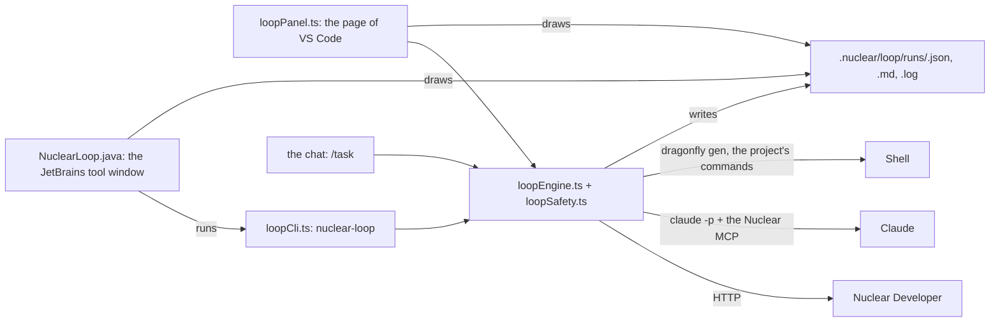

# Architecture of the Loop

## The parts

| Part | File | What it does |
|---|---|---|
| The engine | `loopEngine.ts` | `Spec`, `Run`, `Stage`, `Step`; `LoopEngine.start()` runs the stages and saves the run on every step (`change` event). No `vscode` import |
| Safety | `loopSafety.ts` | atomic writes, the trace log, the heartbeat, the ledger and its rollback, the check of the connections. No `vscode` import |
| The page | `loopPanel.ts` | one full-screen webview of the strip (id `loop`, `Ctrl+Alt+P`), like Devices and HTTP: the runs, the spec form, a run as a graph. `driveRun` is module-level; `resumeOrphans` runs on activation |
| The command | `loopCli.ts` | `nuclear-loop`, for a terminal, a CI job and the JetBrains tool window |
| JetBrains | `NuclearLoop.java` | the *Nuclear Loop* tool window |

## What it calls

- **The Nuclear Developer** over HTTP (`developerUrl`): `/developer/analyze` (the strategy), `/developer/plan`,
  `/developer/test`, `/developer/code`, `/developer/security`, `/developer/document` (the journal's top),
  `/developer/accept` (the acceptance) and `/developer/diagnose` (why a stage failed). Every call carries the
  project's folder, so an agent reads by itself the files its task names.
- **Claude**, when it leads: `claude -p --output-format stream-json` with the Nuclear MCP server
  (`graphCommand mcp`, `--strict-mcp-config`, `--tools` limited to the stage's built-ins). Every tool call is a
  step; `developer_*` calls are drawn as the local agent.
- **The generators**: `dragonfly gen resource ... --from-spec`, `dragonfly gen usecase`.
- **The project's commands** of `.nuclear/loop.json`.
- **Jira** (REST v3, ADF to text) and **GitHub** (`gh issue view`), to import a spec.

## What it writes in a project

| File | What |
|---|---|
| `specs/<id>/spec.md` | the spec, written by the specification stage |
| `.nuclear/loop/runs/<id>.json` | the run, saved on every step: the file every editor draws |
| `.nuclear/loop/runs/<id>.md` | the journal |
| `.nuclear/loop/runs/<id>.review.md` | a reviewer's notes |
| `.nuclear/loop/runs/<id>.log` | the trace log (JSON lines) |
| `.nuclear/loop.json` | the commands of each stage (`defaultConfig(platform)`) |
| `.github/workflows/nuclear-loop.yml`, `.gitlab-ci.yml`, `bitbucket-pipelines.yml` | the exported CI (`ciFile()`) |

Configuration, weakest first: the machine's defaults < the editor's `nuclear.ai.*` settings < the project's
`.nuclear/loop.json` (`readConfig(root, platform, machine)`). Jira's site, email and API token are in VS Code's
secret storage (`nuclear.loop.jira`).

## The page (`loopPanel.ts`)

- The runs of the active project on the left.
- The spec form: use case → the spec written or imported → context → who leads, with an optional preview of the plan
  by the local planner.
- A run as a graph: a column per stage, a node per step in the order it ran, the steps its agent followed as nodes
  under it, edges between them. A click on a node opens a drawer beside the graph (*What it did*, its decisions,
  input, output, code) with *Run again from this step*. Each stage has *Run <stage> again*, and the run *Run again
  from scratch* (a modal confirmation: it undoes files).
- The messages of the webview: `retry`, `retryStep`, `retryStage`, `scratch`.

## The command (`loopCli.ts`)

`npm run loop` → `out/nuclear-loop.js`, also part of `compile`. The project is the closest folder up with
`config.nuc`.

| Command | What it does |
|---|---|
| `nuclear-loop run [spec.md] [--lead local\|claude]` | the whole pipeline (`parseSpecMarkdown`, the inverse of `specMarkdown`); no file = the spec changed last |
| `nuclear-loop retry <run> [--from <stage> \| --step <id>]` | a run again from the step that failed, a whole stage, or any step of it |
| `nuclear-loop restart <run>` | the whole pipeline again from scratch |
| `nuclear-loop ci [stage...]` | the deterministic stages of `.nuclear/loop.json` (`ciCommands`, the same grouping `ciFile` exports) |
| `nuclear-loop export github\|gitlab\|bitbucket` | writes the CI file |
| `nuclear-loop runs` | the runs of this project |
| `nuclear-loop setup [--profile <id>] [--yes] \| --status \| --remove` | the AI services of this machine ([the set-up](../../../../vscode/docs/02-architecture/ai-services.md)) |

## The JetBrains tool window (`NuclearLoop.java`)

Bottom, `Alt+Shift+P`. Per project (`NuclearHttp.findProjects`): its specs (`specs/*/spec.md`) and its runs
(`.nuclear/loop/runs/*.json`, newest first) → stages → steps (actor, summary, status colors). Below, the selected
step's trace, input, code and output; a step's file opens. Title actions: New Spec (writes the markdown shape
`parseSpecMarkdown` reads), Run the Spec with the local agents or with Claude leading, Server Stages, Export CI,
Stop, Refresh. Each runs `nuclear-loop` in the project and streams its output; the tree reads the run again every
1.5 s and keeps the selection. It has no Retry buttons, and it was never loaded in a running IDE.
