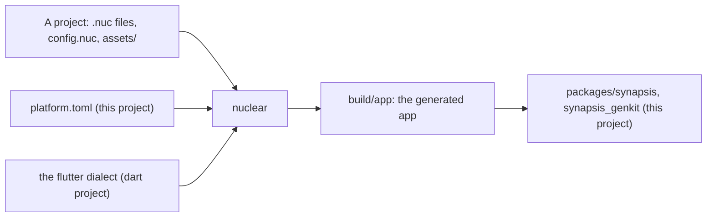

# Architecture

## The parts

| Part | Where | Owner |
|---|---|---|
| The contract of the platform | `platform.toml` | this project |
| The runtime packages | `packages/synapsis/`, `packages/synapsis_genkit/` | this project ([runtime.md](runtime.md)) |
| The examples and their goldens | `examples/` | this project |
| The checks | `checks/` | this project ([testing.md](../05-standards/testing.md)) |
| The dialect `flutter`: kinds as templates, the generated files, the manifest, the toolchain | `nuclearlang/dialects/dart/frameworks/flutter/` | the [`dart` dialect project](../../../../../nuclearlang/dialects/dart/AGENTS.md) |
| The type definitions of the toolkit and of the runtime packages | `nuclearlang/dialects/dart/defs/` | the `dart` dialect project |
| The loader, the transpiler, the architecture checks | `nuclearlang/crates/` | the [language project](../../../../../nuclearlang/AGENTS.md) |
| `nuclear new/build/test/run` | `tools/cli/src/framework/` | the [CLI project](../../../../../tools/cli/AGENTS.md) |
| What `nuclear make` and `nuclear gen` write | `tools/code_generator/platforms/mobile/generators.toml` | the [code generator](../../../../../tools/code_generator/AGENTS.md) |
| The tutorial and the guides shared by the platforms | `nuclear-synapsis-framework/docs/08-guides/` | the [framework](../../../../AGENTS.md) |

## The contract: `platform.toml`

What each section of a contract means, what the loader checks and how a contract is changed are the same for the
three platforms: [the contract of a platform](../../../docs/02-architecture/contract.md). What this one holds:

| Section | In the mobile contract |
|---|---|
| `[platform]` | `name = "mobile"`, `default_dialect = "flutter"`, 25 `kinds`, the `decorators` a project may write, the `plugins` `genkit`, `firebaseAI`, `googleAI`, `vertexAI`, `openAI`, `anthropic` |
| `[decorators.args]` | the arguments of the data decorators, the same as the backend platform's (ADR-backend-0001): `primary = ["generated", "length"]` |
| `[decorators.replaced]` | `generated` → `@primary(generated = true)` |
| `[layout]` | the file of each of the 25 kinds ([project.md](project.md)) |

It has no `[decorators.fields]`.

What `nuclear gen` writes is not in the contract: it is `tools/code_generator/platforms/mobile/generators.toml`,
read by the loader with the contract:

| Section | In the mobile generators |
|---|---|
| `[gen]` | how `nuclear gen` writes the connection of an HTTP resource: the default one, or a named one when the app has another |
| `[[generators.component]]`, `[[generators.resource]]`, `[[generators.usecase]]` | what `nuclear gen` writes (ADR-codegen-0001): the next section |

It has no `[skeletons]`.

## The generators

`nuclear gen` writes finished, compiling Nuclear from a resource's data; the values a template may use are listed
in the comments of `tools/code_generator/platforms/backend/generators.toml`. The mobile platform reads other APIs (`--source rest`); its local
database is the repositories' `saveLocal`, not a resource of its own. What the command does for the user:
[mobile.md §2, Generators](../07-reference/mobile.md).

| Generator | Writes | Condition |
|---|---|---|
| `component` | the facade `<Component>Component` | merged into an existing one |
| `resource` | one model per model of the answer | `each = "models"`, `when = "rest"` |
| `resource` | `<Name>Error` with `message` | `when = "rest"` |
| `resource` | `<Name>Repository`: `all`/`page`, `one`, `search`, `create`, `update`, `remove`, by action | `when = "rest"`, merged |
| `resource` | one use case per action | `each = "each_action"` |
| `resource` | an alias per use case in the facade | merged |
| `resource` | `<Names>State`, `<Names>Manager`, `<Names>Screen` (a list) | `when = "screen"` |
| `resource` | `<Names>Test`: the repository mocked, everything else the real code | `when = "actions.list"` |
| `usecase` | a use case over one repository method that answers a `Result` | `when = "result"` (`--calls`) |
| `usecase` | its alias in the facade | merged |

`merge = true` gives an existing declaration only the members it lacks, so an action added to a resource that
exists is finished (ADR-developer-0001). What a screen shows of a generated use case is its state manager's, written by
hand.

## The examples

| Path under `examples/` | What it shows |
|---|---|
| `examples-flutter-dialect/clean-flutter-project/` | the complete app: characters, episodes, session, forms, translations, guards, events, a splash. Golden in `expected/clean-flutter-project/`. `nuclear test` 34 tests, integration on Linux, `flutter analyze` 0, `flutter build web` and `linux` |
| `examples-flutter-dialect/genkit-assistant/` | the `genkit` plugin: a chat with tools, a flow, a knowledge base, a remote flow. Golden in `expected/genkit-assistant/` |
| `examples-flutter-dialect/tasks_app/` | a client generated from a backend's contract (`contracts/tasks_api/`, ADR-synapsis-0006); built and tested by the CI |
| `examples-flutter-dialect/{flutter_app,widgets_tour,framework_libs,dart_extension}.nuc` | single-file examples, each with its golden `.dart` beside it |

Who reads them: the compiler's tests (`nuclearlang/crates/nuclear-transpile/tests/{golden,projects}.rs`,
`nuclearlang/crates/nuclear-lsp/tests/server.rs`), the two scripts of `checks/` and the flutter reference, whose
Synapsis blocks are the files of `clean-flutter-project`.

## CI

`.github/workflows/platform-mobile.yml`: the reference's examples (`spec-check-synapsis.py`, then the language's
`spec-check` over the flutter reference), the runtime (`flutter pub get && flutter test && flutter analyze` in
`packages/synapsis`), an install of `nuclear`, the backend example built, and `tasks_app` built
and tested.
