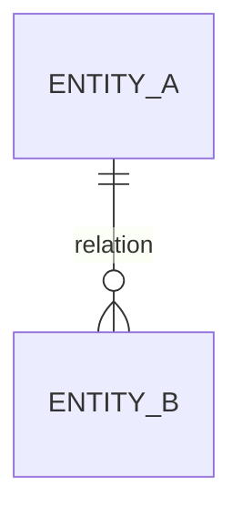

# Domain model

## Main entities

TODO(user): the real entities (each one becomes a model of a component: `nuclear gen resource`).

## Business rules

- BR-001: TODO(user)

## Invariants (what must never break)

- INV-001: TODO(user)
