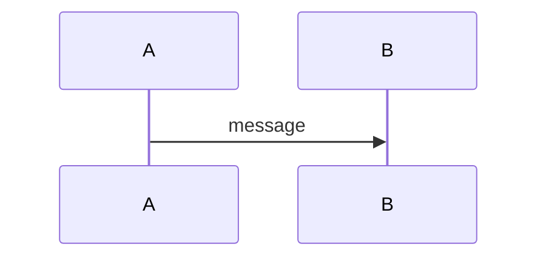

# Spec NNN: <feature>: Design

## The solution in short

## Pieces affected

Each piece is a kind of the platform, made with `nuclear gen` or `nuclear make`.

| Piece | Change |
|---|---|
| | |

## Data model / migrations

## Contracts (API, events)

## Sequence diagram

## Decisions (link the ADRs)

-

## Risks and mitigations

| Risk | Mitigation |
|---|---|
| | |

## Test strategy

<Which tests cover each acceptance criterion.>
